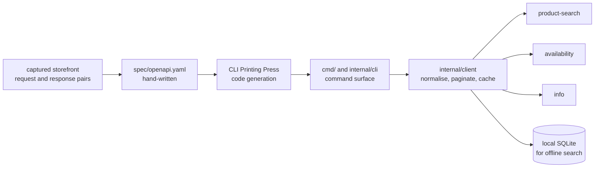

# verkkokauppa-cli

A Go CLI for [Verkkokauppa.com](https://www.verkkokauppa.com), Finland's largest consumer
electronics retailer: search the catalogue, filter on facets, check per-store stock, and watch
prices.

## Why it exists

The storefront talks to three JSON services that are not documented and do not hand out keys. The
interesting work was mapping them; the CLI is what falls out of that map.

| Upstream path | Answers | Gotcha |
| --- | --- | --- |
| `/fi/api/v1/product-search` | query, facets, sort, pagination, with prices and discounts embedded | rejects a request with no `sessionId`; any random UUID works |
| `/fi/api/v1/availability` | per-store stock for a set of SKUs | batches of SKUs, not one per call |
| `/api/v1/info` | brand, category breadcrumbs, list price, active discount | one call per product id |

Pricing is the part worth knowing. The search response carries a current price and a separate
list price, and the discount is frequently expressed on the list price rather than the item, so a
naive subtraction reports discounts that are not there. `internal/client` normalises all three
responses into one product shape before anything above it sees them.

## How it is built



`spec/openapi.yaml` is the hand-written artifact: the endpoint shapes, the facet model, the
pagination behaviour, and the field normalisation rules. Everything in `cmd/` and most of
`internal/cli` is generated from that spec by [CLI Printing Press](https://github.com/mvanhorn/cli-printing-press),
which also supplies the agent-facing commands you will see in `--help` (`recall`, `teach`,
`playbook`, `learnings`). Those are the framework, not the domain work. `NOTICE` says the same
thing.

The reason to generate rather than hand-write is that the command surface, the help text, the JSON
output and the exit codes all stay in one place. Changing the spec changes all four at once.

## Build and test

```bash
go build ./cmd/verkkokauppa-pp-cli
go test ./...
```

Go 1.26 or newer. No API key, no account, no configuration.

## Commands

```bash
verkkokauppa-pp-cli search "rtx 5090" --json
verkkokauppa-pp-cli fi products get <id>
verkkokauppa-pp-cli sync                      # mirror the catalogue into local SQLite
verkkokauppa-pp-cli search "ssd" --offline    # query the mirror instead of the network
verkkokauppa-pp-cli vk deals                  # current discounts above a threshold
verkkokauppa-pp-cli vk watch add <id>         # record a price, diff on the next run
verkkokauppa-pp-cli doctor                    # connectivity and auth check
```

`--agent` on any command switches to JSON, non-interactive, no-colour output.

## What it does not do

It does not place orders or touch a cart. It reads the catalogue and the stock endpoint and
nothing else.
